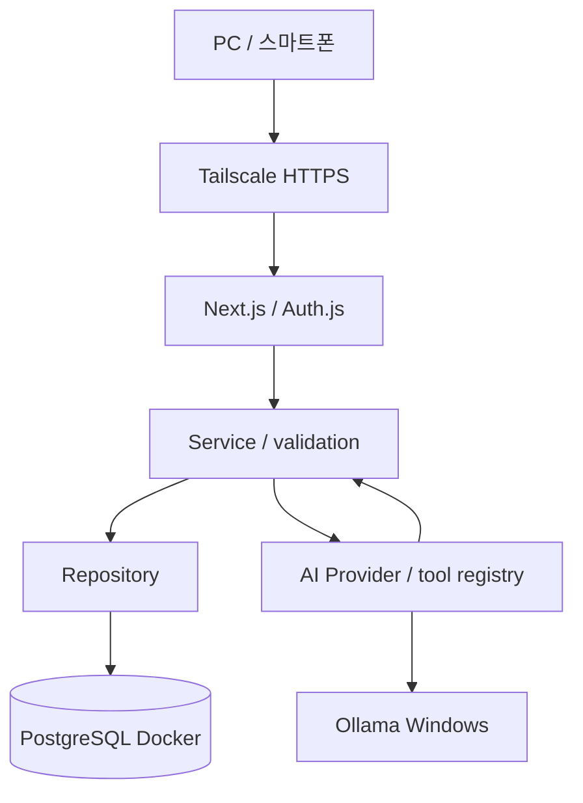

# 아키텍처 v0.1

모듈러 모놀리스. 별도 Spring Boot, nginx, Redis, Kafka, Kubernetes, LangChain은 초기 제외.


Next.js 및 PostgreSQL은 운영 Docker Compose, Ollama는 호스트 직접 설치. Docker 내부 PostgreSQL은 서비스명으로 접근하며 운영 DB 포트는 publish하지 않는다. Docker Desktop에서 Ollama 접속은 `host.docker.internal:11434` 후보이나 기본 loopback 바인딩과 실제 접근 가능성을 확인해야 한다. 필요 시 제한된 호스트 인터페이스/방화벽 규칙을 승인 후 구성하거나 초기 Next.js를 호스트에서 실행한다. Tailscale Serve HTTPS로 웹만 제공하고 Funnel은 사용하지 않는다. 외부 포트포워딩 금지.

## 폴더
```
src/app/(auth)/login/
src/app/(dashboard)/[각 화면]/
src/app/api/
src/components/
src/features/[모듈]/
src/services/
src/repositories/
src/lib/ai/
src/lib/db/
src/types/
src/hooks/
database/migrations/
database/seeds/
docs/
tests/
```
API: GET/POST `/api/schedules`, GET/PATCH/DELETE `/api/schedules/:id`를 기본 패턴으로 한다. `/api/tasks`, `/api/transactions`, `/api/inventory`, `/api/utilities`, `/api/notes`, `/api/learning`, `/api/analytics`, `/api/dashboard`, `/api/settings`, `/api/ai/chat`, `/api/chat/sessions`, `/api/ai/confirm` 등. 조회 전용 기능에는 불필요한 CRUD를 만들지 않는다. 응답 오류는 일관된 코드와 사용자 메시지를 사용한다.

## AI 처리
Provider 인터페이스는 메시지, 허용 도구 스키마, 모델 설정을 받고 구조화된 응답/도구 요청을 반환한다. Ollama `/api/chat` 우선. 모델별 도구 호출 지원과 JSON 구조화 출력 검증; 필요 시 JSON 의도 분류로 대체한다. 서버에서 도구 이름과 파라미터 검증, 사용자 소유권 검사, 읽기는 즉시 실행, 쓰기는 확인 후 실행. 결과를 모델에 전달하거나 서버에서 성공 메시지 생성. 도구 반복 횟수 제한, 타임아웃 및 취소 적용. 데이터 원문은 신뢰하지 않는다.

컨텍스트: 시스템 규칙 + 필요한 사용자 기억 + 최근 메시지(초기 10개 상한 후보, 토큰 예산도 적용) + 관련 데이터 + 현재 요청. 전체 DB나 대화 이력을 매번 전달하지 않는다. 장기 기억은 사용자가 수정·삭제 가능하도록 한다. 데이터 삭제 정책과 로그 보존 기간은 구현 때 확정한다.

## 환경 분리
개발 3000, 운영 3001 제안. 별도 DB/계정/볼륨/환경변수. 운영 데이터 복제 금지. `.env.example`에는 placeholder만. 개발 DB 포트가 필요하면 loopback에만 바인딩. 운영 DB 백업은 암호화 및 별도 저장장치 권장, 복구 테스트 필수.

초기 라이브러리 추가 제안: pg(파라미터 SQL), Zod(검증), Argon2id 또는 bcrypt(비밀번호 해시). 실제 호환성과 환경 확인 후 확정. Auth.js Credentials/JWT 사용 시 사용자 레코드 및 비밀번호 검증은 앱이 관리하고, 공개 회원가입 없이 최초 계정 생성 절차를 제공한다.

## 운영 저장 경로

데모는 기존 브라우저 저장을 유지한다. 운영 화면은 `/api/workspace`에서 현재 로그인 사용자의 도메인 데이터를 불러온다. Route Handler에서 세션과 변경 요청의 Origin 및 크기를 확인하고, Service에서 도메인 스키마와 중복·상호 참조를 검증한다. Repository는 사용자 ID가 바인딩된 SQL을 사용한다. 동시 변경은 문서 리비전으로 검사해 오래된 쓰기에 409를 반환한다. DB 실패 시 503을 표시하며 브라우저에 쓰지 않는다.

현재 화면이 함께 저장하는 레코드·공과금·고정 지출·기억·테마를 `workspace_documents`의 사용자별 도메인 JSONB로 저장한다. 기존 정규화 테이블은 마이그레이션으로 유지되고, 업무 테이블별 저장·SQL 집계는 후속이다. 화면 통계는 PostgreSQL에서 읽은 자료를 기존 집계 규칙에 넣어 계산한다. 브라우저 가져오기는 대상 영역이 모두 비어 있는 경우 한 트랜잭션으로 적용한다.

운영 채팅의 조회·변경은 인증된 `/api/workspace`의 채팅 작업을 통해 Chat Repository가 세션과 메시지 테이블에 적용한다. 같은 사용자 행을 잠가 채팅 작업과 브라우저 이관의 충돌을 막는다. 저장된 질문 ID를 기준으로 답변을 한 건만 저장할 수 있다. 사용자가 명시적으로 다시 시도할 경우 기존 질문의 문맥을 재사용한다. AI Provider는 요청 취소 및 서버 대기 시간 제한을 적용하며 실패 로그에 원문을 넣지 않는다.

## 일상·구독 도메인

일상과 구독은 동일한 사용자별 Repository 및 /api/workspace 저장 경로를 쓴다. 일정에 나타나는 활동 및 구독 이벤트는 원본에 연결되는 안정적인 ID의 조회 결과다. 돌아가며 결제는 가계부에 자동 반영하지 않는다. 사용자가 확인한 직접 지출은 구독 결제 이력을 원본으로 표시하고 집계한다. 원본 거래나 고정지출에 연결한 결제는 기존 자료에서만 지출로 집계한다. 고정지출과 구독을 연결하면 이후 예정액은 구독 주기를 따른다. 로그인 사용자의 문서 잠금 안에서 거래·고정지출·정산·야구와의 참조 및 중복을 검사한다. 앱 내부 알림은 예정일까지 남은 일수로 조회한다.
